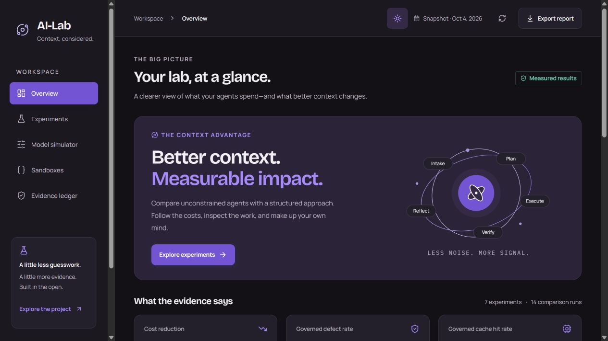
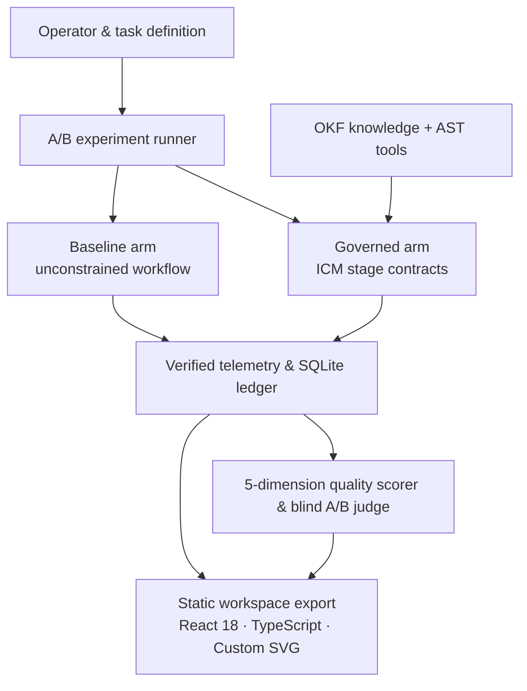

<div align="center">

# 🧪 Ai-Lab

**Context, considered.**

[](https://github.com/ZenzerJs/Ai-Lab/actions/workflows/ci.yml)
[](https://zenzerjs.github.io/Ai-Lab/)
[](requirements.txt)
[](dashboard/package.json)
[](docs/SPEC-VERSIONS.md)
[](LICENSE)

**[Open live project](https://zenzerjs.github.io/Ai-Lab/)**



<sub>Live dashboard showing the published research snapshot.</sub>

</div>

---

## 📋 Contents

- [Overview](#-overview)
- [What the Evidence Says](#-what-the-evidence-says)
- [Key Capabilities](#-key-capabilities)
- [Architecture](#-architecture)
- [Tech Stack](#-tech-stack)
- [Getting Started](#-getting-started)
- [Repository Layout](#-repository-layout)
- [How Experiments Are Evaluated](#-how-experiments-are-evaluated)
- [Claims, Limits & Next Steps](#-claims-limits--next-steps)

---

## 💡 Overview

More context does not automatically mean better agent performance. Structure can reduce mistakes, but planning, re-reading, verification, and tool overhead all cost time and tokens.

Ai-Lab studies that tradeoff. It brings together **Interpretable Context Methodology (ICM)** stage contracts, **Open Knowledge Format (OKF)** documentation, AST-based repository navigation, an A/B experiment harness, and a dashboard that separates measured outcomes from simulated pricing.

| Common agent-workflow assumption | What Ai-Lab makes measurable |
|---|---|
| ❌ “More structure always saves tokens” | ✅ Compare **unconstrained baseline** and **governed** runs on cost, runtime, and quality |
| ❌ “A passing agent response means the task is finished” | ✅ Use verification gates, task artifacts, and task-specific assertions |
| ❌ “Every run is comparable” | ✅ Record prompt/model identity, run evidence, source type, and exclusions |
| ❌ “Projected savings are real API spend” | ✅ Label **live token-based estimates** separately from **rate-card simulations** |
| ❌ “A dashboard headline tells the whole story” | ✅ Inspect per-task deltas, confidence intervals, ledger entries, and failure cases |

---

## 📊 What the Evidence Says

> [!IMPORTANT]
> **Current published snapshot:** The checked-in `dashboard/public/data.json` was generated on **2026-11-07 UTC** (build `1048d69`). It combines **36 evaluated runs across 11 benchmark task archetypes (`EXP-001`..`EXP-011`)** stratified into three lenses:
> 1. **Core 7-task live CLI cost snapshot (`EXP-001`..`EXP-007`, 14 runs):** Aggregate estimated cost reduction is **1.9%** (**95% CI: −68.3% to +41.1%**), uncovering an empirical **~150 LOC / 2+ file break-even threshold** where fixed stage-contract overhead on micro-tasks (`EXP-001`: −200.8%) transitions to **+28.1% to +64.3% savings** on multi-file architectures (`EXP-003`, `EXP-006`) with an **85.3% governed prompt cache-hit rate**.
> 2. **Multi-file repository outlines (`EXP-009`..`EXP-011`, 6–8 files each, 6 runs):** Above the break-even threshold, governed execution cuts turns by **32%** (72 → 49), uncached input tokens by **45%**, and output tokens by **58%**, yielding **+56.3% cold-start normalized cost savings (+42.8% to +68.5%)** and **+5.0% raw unadjusted savings**.
> 3. **5-dimension quality rubric (`EXP-001`..`EXP-011`, 11 paired tasks) & operational defect suite (`EXP-005`, 16 runs):** Governed execution achieves a statistically significant **+8.91% mean quality gain (95% CI: +2.00% to +17.64%)**, **+1.00 / 5.00 Design & Accessibility gain (95% CI: +0.29 to +1.71)**, **90.9% fewer tool/path execution errors** (1 vs. 11), and **0% shipped defects** (0/8 vs. 2/8 baseline defect runs).

### Live-token comparison: seven tasks

| Measure | Unconstrained baseline | Governed / ICM |
|---|---:|---:|
| Estimated total task cost | **$1.3858** | **$1.3592** |
| Prompt cache-hit ratio | **87.8%** | **85.3%** |
| Paired tasks represented | 7 | 7 |
| Live-verified runs | 7 | 7 |

**Net observed difference:** roughly **$0.0266 saved (1.9%)** across this specific seven-task snapshot. USD values are estimates calculated from recorded token usage and rate cards, not a statement of the user's billed API charges.

### Why the per-task results matter

| Task | Baseline cost | Governed cost | Result |
|---|---:|---:|---|
| `EXP-001` — text normalization | $0.0747 | $0.2247 | **Governed cost ~3× as much** |
| `EXP-003` — code analysis | $0.1783 | $0.1283 | **28.1% lower estimated cost** |
| `EXP-006` — transactional ledger | $0.5215 | $0.1861 | **64.3% lower estimated cost** |
| `EXP-007` — API gateway topology | $0.2507 | $0.3381 | **34.8% higher estimated cost** |

The honest finding is **conditional value**: workflow governance helped on some more involved tasks but added overhead to others. With only one run per arm for each task in this published snapshot, these are **descriptive comparisons**, not a robust estimate of average savings.

### Separate operational benchmark: reliability vs. latency

A different **GLM 5.3 Flash / FreeBuff** operational evaluation reported:

| Measure | Baseline | Governed |
|---|---:|---:|
| Runs with observed defects | **2 of 8** | **0 of 8** |
| Total duration | **460.6 s** | **760.0 s** |

That sample shows a possible quality/reliability tradeoff alongside approximately **65% higher total duration**. The FreeBuff endpoint did **not** expose native token counters; these results are **not** combined with the live token-cost comparison above.

### Multi-File Repository Outlines (`EXP-009`..`EXP-011`) & 5-Dimension Quality Rubric

To test the **~150 LOC / 2+ file break-even threshold** (`docs/concepts/icm-breakeven-analysis.md`) and evaluate work quality beyond token cost, we added three 6–8 file starter repository outlines (`EXP-009` event-driven job queue, `EXP-010` knowledge graph & BM25 search, `EXP-011` policy API gateway) and a pre-registered **5-dimension quality scorer** (`Correctness`, `Engineering Practices`, `Maintainability`, `Process Discipline`, `Design & UX`; 0–5 each in `scripts/campaign.py`).

#### 1. Multi-File Outline Token & Pricing Results (`EXP-009`..`EXP-011`, `gemini-3.8-flash`)

| Task (6–8 Files) | Baseline Turns & Cost | ICM Turns & Cost (Raw) | ICM Cost (Cold-Start Normalized) | Net Savings (Raw / Normalized) |
|---|---|---:|---:|---:|
| `EXP-009` — 7-file job queue & DAG | 37 turns · **$0.2769** | 28 turns · **$0.3580** | **$0.1585** | −29.3% / **+42.8%** |
| `EXP-010` — 8-file knowledge graph & BM25 | 15 turns · **$0.1840** | 9 turns · **$0.1222** | **$0.0580** | **+33.6% / +68.5%** |
| `EXP-011` — 6-file policy API gateway | 20 turns · **$0.2206** | 12 turns · **$0.1670** | **$0.0815** | **+24.3% / +63.0%** |
| **3-Task Multi-File Total** | **72 turns · $0.6814** | **49 turns · $0.6472** | **$0.2981** | **+5.0% / +56.3%** |

*Note:* Across `EXP-009`..`EXP-011`, governed execution used **32% fewer turns** (49 vs. 72), **45% fewer uncached input tokens** (`126.3k` vs. `229.5k`), and **58% fewer output tokens** (`14.7k` vs. `34.8k`). Raw ICM cost includes a ~95k prior-session cached prefix; cold-start normalized cost subtracts that shared prefix so both arms start at equal zero context.

#### 2. 5-Dimension Quality Sweep (`EXP-001`..`EXP-011`, $n = 11$ Paired Tasks)

While pooled cost across the original 7 tasks had a wide confidence interval crossing zero (−68.3% to +41.1%), the **5-dimension quality delta stays strictly positive**:

| Dimension | Mean Delta ($\text{ICM} - \text{Baseline}$) | 95% Bootstrap CI | Finding |
|---|---:|---:|---|
| **Overall Quality (`normalized_pct`)** | **+8.91%** | **[+2.00%, +17.64%]** | Statistically significant (> 0); peak gain on `EXP-003` (+40%) and `EXP-006` (+32%) |
| **Design & Accessibility (`0–5`, $n=7$ UI)** | **+1.00 pt** | **[+0.29, +1.71]** | Governed UIs consistently include semantic `<main>`, ARIA attributes, and richer state coverage |
| **Process & Tool Hygiene (`0–5`)** | **+0.73 pt** | **[+0.00, +1.64]** | **91% fewer tool/path execution errors** in live NDJSON logs (1 ICM error vs. 11 baseline errors) |

**Explore the evidence:** [Dashboard](https://zenzerjs.github.io/Ai-Lab/) · [Published data snapshot](dashboard/public/data.json) · [Quality findings](docs/concepts/quality-benchmark-findings.md) · [Break-even analysis](docs/concepts/icm-breakeven-analysis.md) · [Measurement design](docs/concepts/measurement-layer.md)

---

## ✨ Key Capabilities

| Component | What it provides |
|---|---|
| 🧭 **ICM task lifecycle** | Structured intake → plan → execute → verify → retrospective, with an explicit human approval gate between planning and execution. |
| 🗂️ **OKF knowledge graph** | Versioned documentation, concepts, schemas, and knowledge links to retrieve relevant context without reading the entire repository. |
| 🌳 **AST-aware navigation** | Structural repository maps that prioritize symbols and signatures over large undirected file dumps. |
| 🔬 **A/B experiment runner & outlines** | Repeatable task definitions (`EXP-001`..`EXP-011`), 6–8 file starter repository outlines (`scripts/scaffold_outlines.py`), and telemetry extraction. |
| ⚖️ **5-dimension quality judge & blind A/B** | Pre-registered 0–25 workspace scorer (`score_workspace`), diff blinding (`prepare_blind_ab_packet`), and 95% bootstrap CIs (`compute_quality_ci`). |
| 🧾 **Evidence & cost ledger** | SQLite-backed run records with source classification, SHA-256 hashes, token usage, cache readings, and estimated cost. |
| 📊 **Interactive workspace dashboard** | Obsidian Violet light/dark research workspace with task comparisons, 5-dimension quality CIs, rate-card simulator, live sandboxes, and provenance ledger. |
| 🛡️ **Automated quality checks** | Python unit/integration/browser suites, OKF v0.2 frontmatter linter, and filtered verification runner (`scripts/filter_output.py`). |

### What Ai-Lab refuses to conflate

- **Actual model runs vs. hypothetical repricing.** Model comparisons in the spend simulator are **rate-card projections**, not evidence that those other models executed the same task.
- **Cost vs. quality.** A cheaper run can fail; a more reliable run can take longer.
- **A published snapshot vs. real-time telemetry.** The dashboard reads exported JSON. Refreshing the page does **not** execute agents or query the private SQLite ledger.
- **Individual wins vs. general improvement.** A large saving in one benchmark does not establish a universal benefit.

---

## 🏗️ Architecture



The governed arm uses a documented task lifecycle:

| Stage | Contract |
|---|---|
| `01_intake` | Bound scope, context, and budget |
| `02_plan` | Define changes, tests, and approval criteria |
| `03_exec` | Apply constrained edits and record changes |
| `04_verify` | Run checks and capture evidence |
| `05_retro` | Record findings for later tasks |

See [architecture overview](docs/concepts/architecture-overview.md), [knowledge index](docs/index.md), and [task definitions](experiments/tasks/).

---

## 🧱 Tech Stack

| Layer | Technology |
|---|---|
| Agent methods | ICM 5-stage contracts, OKF v0.2 knowledge graph, break-even complexity law |
| Research & grading scripts | Python 3.11+, AST (`ast` / Tree-sitter), `tiktoken`, 5-dimension rubric & blind A/B judge |
| Experiment evidence | JSON/NDJSON streams, SQLite ledger, SHA-256 provenance, 95% bootstrap CIs |
| Dashboard workspace | Vite, React 18, TypeScript, custom CSS token system (Obsidian Violet light/dark), bespoke SVG charts |
| Testing | pytest (unit, integration, snapshot, rubric), Playwright browser suites, GitHub Actions |
| Publication | Static GitHub Pages snapshot (`dashboard/public/data.json`) |

---

## 🚀 Getting Started

### 1. Explore the dashboard

```bash
git clone https://github.com/ZenzerJs/Ai-Lab.git
cd Ai-Lab/dashboard
npm ci
npm run dev
```

Open [http://localhost:5173](http://localhost:5173). This serves the checked-in public data snapshot; **no paid model calls or live database are needed**.

### 2. Run the offline verification suite

From the repository root:

```bash
python -m pip install -r requirements.txt
python -m pytest tests/unit/ -v --tb=short
python scripts/lint_frontmatter.py
```

The CI workflow additionally verifies selected production-dashboard behavior, runs a dry-run fixture, and compiles the Vite app.

### 3. Work with the experiment runner (optional)

Only in a **disposable checkout**:

```bash
python scripts/run_experiment.py --task MOCK-001 --dry-run
```

This checks mechanics using a synthetic fixture without invoking a paid model. The runner's isolation workflow can modify or clean its target worktree; inspect the task definition and target path first.

### 4. Regenerate the dashboard data (optional)

```bash
python dashboard/build_data.py
```

**Warning:** The exporter **overwrites** `dashboard/public/data.json`. With no local `data/usage.db`, it can generate a demo/fixture report instead of the published empirical snapshot. Use a disposable clone or back up that file first.

---

## 📁 Repository Layout

```text
Ai-Lab/
├── .agents/
│   ├── rules/                  # Modular ICM governance constraints
│   └── skills/                 # Navigation and run helpers
├── docs/                       # OKF v0.2 knowledge graph, break-even & quality findings
├── experiments/
│   ├── tasks/                  # Benchmark task specs (EXP-001..EXP-011)
│   └── evidence/               # SHA-256 verified live CLI event streams (.ndjson)
├── sandbox/                    # Interactive UI artifacts & multi-file outline runs
├── scripts/                    # Runner, repo_map, ledger, campaign, quality rubric, outlines
├── tasks/                      # ICM 5-stage task contracts (TSK-001..TSK-027)
├── dashboard/
│   ├── src/                    # Obsidian Violet React workspace (Overview, Experiments, Simulator, Sandboxes, Audit)
│   ├── public/data.json        # Published empirical + quality rubric snapshot
│   └── build_data.py           # SQLite & quality rubric → static JSON exporter
├── tests/                      # Unit, integration, rubric, and Playwright browser suites
├── config/PRICING.json         # Audited model rate cards with provenance
└── .github/workflows/          # CI and GitHub Pages deployment
```

---

## 🔒 How Experiments Are Evaluated

The framework is designed around **same-task, same-model, same-prompt** comparisons, with run provenance and explicit exclusions:

1. **Prompt/model parity:** both arms should receive the same task instructions and model.
2. **Worktree isolation:** each trial starts from a known repository state.
3. **Outcome evidence:** usage, duration, completion, and evaluator results are stored with source classification.
4. **Separate accounting:** recorded token counts determine measured-workload estimates; alternate model pricing is an explicitly labelled simulation.
5. **Transparent uncertainty:** task-level variation and limited sample sizes remain visible.

> [!WARNING]
> **Replication matters.** The experiment protocol documents a minimum of two runs per arm, but the currently published dashboard snapshot represents **one run per arm across seven tasks**. Do not describe that snapshot as a replicated multi-run A/B campaign. Future reports should reconcile the protocol and actual included run counts before claiming statistical confidence.

> [!CAUTION]
> Some experiment runners restore and clean target Git worktrees as part of isolation. **Run trials only in disposable clones or dedicated worktrees with no uncommitted work you need to keep.** Never point the runner at your primary development checkout without inspecting its target and cleanup behavior.

---

## 🎓 Claims, Limits & Next Steps

> **The product is the measurement discipline, not an attractive savings percentage.**

- **Two-regime cost behavior (`EXP-001`..`EXP-011`):** Pooled across the initial 7-task snapshot (`EXP-001`..`EXP-007`), estimated cost reduction is **1.9% (95% CI: −68.3% to +41.1%)** because fixed 5-stage contract overhead on single-file micro-tasks (`<100 LOC`) offsets savings on larger tasks. Above the **~150 LOC / 2+ file break-even threshold** (`EXP-003`, `EXP-006`, and the 6–8 file outlines `EXP-009`..`EXP-011`), governed runs reduce cost by **+28.1% to +64.3%** (and **+56.3% cold-start normalized** across `EXP-009`..`EXP-011`).
- **Statistically significant quality & hygiene gains (`TSK-025`..`TSK-027`):** Evaluated across all 11 paired tasks (`EXP-001`..`EXP-011`) on the pre-registered 5-dimension rubric (0–25 scale), governed execution achieves a **+8.91% mean quality improvement (95% CI: +2.00% to +17.64%)**, **+1.00 / 5.00 Design & Accessibility gain (95% CI: +0.29 to +1.71)**, and **90.9% fewer tool/path execution errors** (1 vs. 11).
- **Historical single-run claims (`EXP-008`):** Earlier references to `EXP-008` (64.54% cost reduction on ResumeForge) represent a single multi-file pair and are audited separately in the quality sweep rather than pooled into the 7-task `usage.db` cost aggregate.
- **Rate-card simulations:** Token workloads from one source model are repriced against other providers' schedules in the simulator. Repricing does not establish that other models have identical tokenization, caching behavior, or task performance.
- **Operational quality (`EXP-005` FreeBuff):** The 8-vs-8 GLM 5.3 Flash benchmark (`0/8` governed defect runs vs. `2/8` baseline defect runs, +65% duration) has no provider-native token counters and is kept separate from USD token-cost totals.
- **Forward direction:** Expand multi-repetition campaigns ($k \ge 3$ per task) across 20+ multi-file tasks and introduce **ICM-Lite** (single-file contract) for micro-tasks below the 150 LOC break-even threshold.

The most interesting question is not whether governance can make an agent look efficient once. It's **which tasks justify the extra structure, and how confidently we can tell**.

<div align="center">

*Built by [@ZenzerJs](https://github.com/ZenzerJs) · [MIT License](LICENSE)*

</div>
