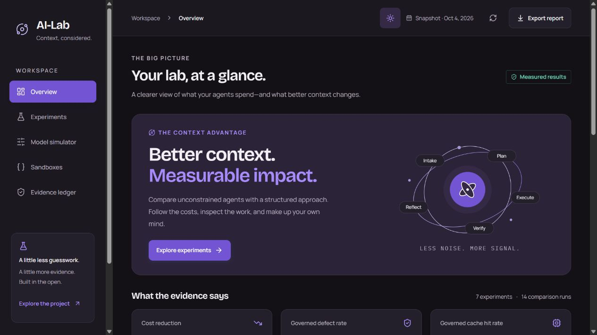
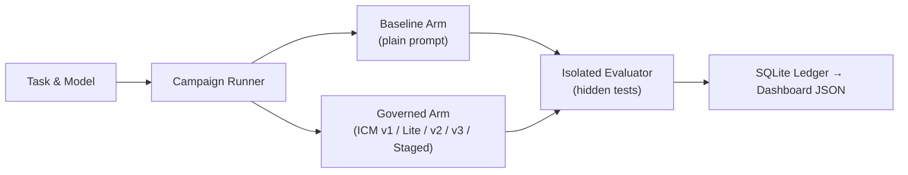

<div align="center">

# 🧪 Ai-Lab

**Does giving an AI coding agent a structured workflow actually save tokens and prevent mistakes—or just add extra steps?**

[](https://github.com/ZenzerJs/Ai-Lab/actions/workflows/ci.yml)
[](https://zenzerjs.github.io/Ai-Lab/)
[](requirements.txt)
[](dashboard/package.json)
[](docs/SPEC-VERSIONS.md)
[](LICENSE)

**[Open live dashboard](https://zenzerjs.github.io/Ai-Lab/)** · **[Test campaign playbook](experiments/ICM-v3-TEST-CAMPAIGN.md)**



<sub>Published research dashboard built from verified trial snapshots.</sub>

</div>

---

## 💡 What Is Ai-Lab?

When coding agents work on multi-file bugs, a plain prompt often burns tokens re-reading files or guessing edits. Adding structure (**Interpretable Context Methodology**, or **ICM**) can keep agents focused—but extra planning turns also cost money.

Ai-Lab measures that tradeoff directly by running the **same coding tasks** on the **same model** with different workflows, then grading every patch in a clean sandbox:

- **Same task, same model:** Baseline prompts run head-to-head against governed ICM contracts in randomized order.
- **Hidden automated grading:** Every trial is checked against isolated unit and invariant tests after the run finishes.
- **Honest accounting:** Real API dollar estimates stay strictly separated from unpriced cohorts and rate-card simulations.

---

## 🧭 The ICM Versions at a Glance

Ai-Lab evolves its workflow contracts step by step and plots every version on a **Cost vs. Pass Rate** chart:

| Version | What changed | Best suited for |
|---|---|---|
| **Baseline** | Plain task prompt with no ICM rules. | Reference anchor for every task. |
| **ICM v1** | Full 5-stage pipeline (`intake → plan → exec → verify → retro`) with written stage files. | Original baseline governance study. |
| **ICM-Lite** | Collapses all 5 stages into one compact contract. | Small single-file fixes (`<150 LOC`). |
| **ICM v2** | Removes stage-file paperwork and injects a compact AST symbol map. | Reducing unnecessary file-read turns. |
| **ICM v3** | Enforces a 3-turn batch-first cadence with a cache-stable repo prefix. | Medium-to-large multi-file tasks (`13–50` files). |
| **ICM Staged** | Splits read-only planning and fresh-context execution into two sessions. | Large repositories (`>50` files) to shed exploration bloat. |

---

## 📊 What the Data Shows So Far

The current snapshot ([`dashboard/public/data.json`](dashboard/public/data.json)) records **802 runs across 41 tasks and 7 models** (`792` live runs + `10` archived imported runs, spanning `34` automated `BENCH-*` suites and `EXP-001`..`EXP-011`).

### Key takeaways

1. **Overall v1 governance is roughly cost-neutral (`-1.5%` pooled savings):** Across `202` priced runs on 4 models, total Baseline spend was **`$8.1634`** vs. **`$8.0391`** for governed runs (`95% CI: -10.0% to +12.5%`). Early 5-stage ceremony (`ICM v1`) helped on big multi-file tasks (`EXP-003`, `EXP-006`) but added overhead on small single-file tasks.
2. **Early `ICM v3` cuts per-run spend in half on Flash:** Across `16` live runs on `gemini-3.8-flash-low`, `ICM v3` averaged **`$0.0593/run`** (`$0.0863/pass`, `11/16` passes) compared to **`$0.1235/run`** (`$0.1560/pass`, `19/24` passes) for Baseline. *(Small early sample — expanding `icm_v3` and `icm_staged` is our top priority.)*
3. **Priced and unpriced cohorts never mix:** Models with audited provider rate cards (`gemini-3.8-flash-low`, `gemini-4-argon-low`, `gemini-4-hydrogen-low`, `claude-sonnet-5-5-low`) contribute to USD totals; large unpriced cohorts (`swe-2-max-lightning`, `gemini-4-neon-devin`, `claude-fable-5-2-devin`) report pass rates, tokens, and tool calls separately.
4. **Quality & scope hygiene improved in paired audits:** On the retrospective 5-dimension rubric (`TSK-025`..`TSK-027`), governed runs scored higher on Design/A11y and structure; see [quality findings](docs/concepts/quality-benchmark-findings.md) and [break-even analysis](docs/concepts/icm-breakeven-analysis.md).

### Snapshot by model (live runs)

| Model | Live runs | Passes | Arms tested | Billing |
|---|---:|---:|---|---|
| `gemini-3.8-flash-low` | 70 | 56/70 | `baseline`, `icm`, `icm_lite`, `icm_v3`, `icm_staged` | Priced USD |
| `gemini-4-argon-low` | 54 | 48/54 | `baseline`, `icm`, `icm_lite` | Priced USD |
| `gemini-4-hydrogen-low` | 50 | 49/50 | `baseline`, `icm`, `icm_lite` | Priced USD |
| `claude-sonnet-5-5-low` | 18 | 17/18 | `baseline`, `icm` | Priced USD |
| `swe-2-max-lightning` | 350 | 242/350 | `baseline`, `icm`, `icm_lite` | Unpriced |
| `gemini-4-neon-devin` | 190 | 128/190 | `baseline`, `icm`, `icm_lite`, `icm_v2` | Unpriced |
| `claude-fable-5-2-devin` | 60 | 42/60 | `baseline`, `icm`, `icm_v2` | Unpriced |

---

## 🏗️ How Experiments Run



1. **Plan:** `scripts/campaign.py plan-batch` generates a SHA-256 signed manifest with randomized arm order.
2. **Isolate:** `scripts/runner.py` creates a fresh disposable worktree per run so agents cannot see hidden evaluator tests or host `.git` history.
3. **Verify:** An independent evaluator grades the saved patch and logs tokens, cache reads, tool calls, and pass/fail status to SQLite (`data/usage.db`).
4. **Publish:** `dashboard/build_data.py` exports the sanitized snapshot to `dashboard/public/data.json`.

---

## 🚀 Quickstart

### 1. View the dashboard locally (no API keys needed)

```bash
git clone https://github.com/ZenzerJs/Ai-Lab.git
cd Ai-Lab/dashboard
npm ci
npm run dev
```

Open [http://localhost:5173](http://localhost:5173). It loads the checked-in `dashboard/public/data.json` snapshot.

### 2. Run the offline verification suite

From the repository root:

```bash
python -m pip install -r requirements.txt
python -m pytest tests/unit/ -v --tb=short
python scripts/lint_frontmatter.py
```

### 3. Run new `icm_v3` / `icm_staged` test batches

Follow [`experiments/ICM-v3-TEST-CAMPAIGN.md`](experiments/ICM-v3-TEST-CAMPAIGN.md) for copy-paste local CLI commands (to hydrate `data/usage.db` and run matched `icm_v3` / `icm_staged` batches on `gemini-4-argon-low`, `gemini-4-hydrogen-low`, and `gemini-3.8-flash-low`) as well as prompts for ChatGPT Codex and Devin/Neon.

> [!CAUTION]
> Experiment runners clone, reset, and delete temporary worktrees during isolation. **Never run live trials against a working checkout with uncommitted edits.**

---

## 📁 Repository Layout

```text
Ai-Lab/
├── contracts/                  # Versioned ICM contracts & SHA-256 registry (v1, lite, v2, v3, staged)
├── benchmarks/                 # 34 isolated multi-file coding suites (BENCH-001..BENCH-034)
├── experiments/                # Legacy EXP tasks, NDJSON evidence logs, & test campaign playbook
├── scripts/                    # Experiment runner, campaign planner, AST repo map, SQLite ledger & hydrator
├── dashboard/                  # React 18 + TypeScript research UI (Overview, Experiments, Analytics, Simulator, Sandboxes, Ledger)
├── docs/                       # OKF v0.2 knowledge base, architecture overview & findings
├── tasks/                      # ICM stage contracts & audit records
└── tests/                      # Python unit, integration, and Playwright browser regression suites
```

---

## 📚 Deep-Dive Docs

- [Architecture overview](docs/concepts/architecture-overview.md) — Runner isolation, AST navigation, and telemetry schema
- [ICM break-even analysis](docs/concepts/icm-breakeven-analysis.md) — Why small tasks pay overhead and multi-file tasks save tokens
- [Quality benchmark findings](docs/concepts/quality-benchmark-findings.md) — 5-dimension rubric scoring and blind evaluation details
- [ICM v3 & Staged test campaign](experiments/ICM-v3-TEST-CAMPAIGN.md) — Priority runs, local commands, and Codex/Neon prompts

<div align="center">

*Built by [@ZenzerJs](https://github.com/ZenzerJs) · [MIT License](LICENSE)*

</div>
